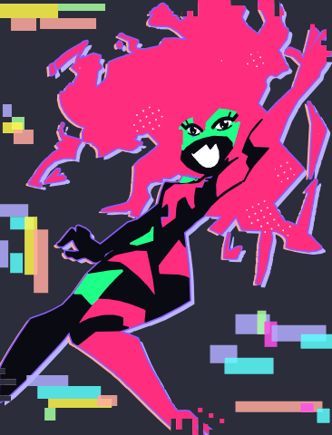
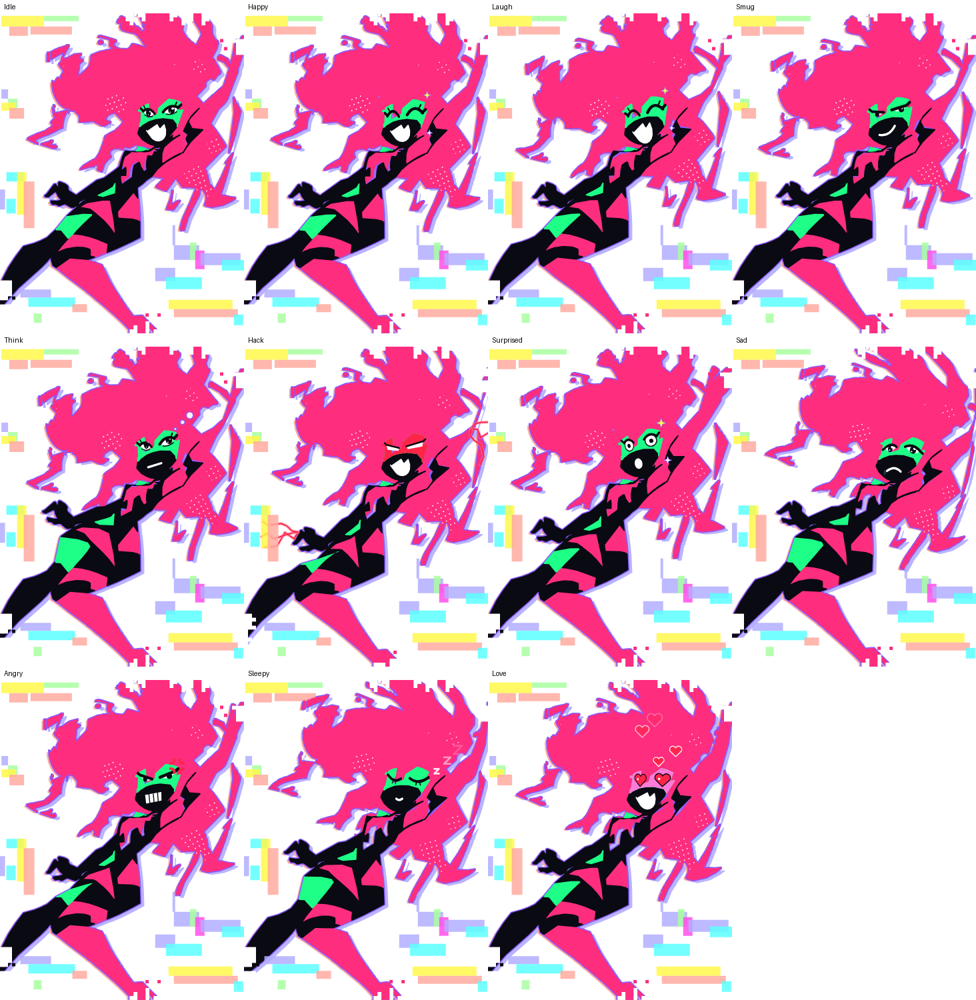

# Capricon — Капри на твоём рабочем столе

Нативное Windows‑приложение (C# / .NET 8 / WPF): анимированная **Капри** живёт поверх окон, говорит голосом, реагирует на твои действия и умеет делать всякое на ПК.

> Фан‑проект по мотивам персонажа Capri из *Cyberpunk: Edgerunners 2*. Не связан с CD PROJEKT RED, Studio Trigger и Netflix.



## Кто она

Капри — цифровая сущность, сшитая из множества оцифрованных разумов. Раньше она жила на украденном корпоративном биочипе, теперь живёт в твоём компьютере. По характеру хаотичная, озорная, как весёлый маленький демон, шумная и дразнящая, но верная. Иногда на неё находит тихая задумчивость: каково это — состоять из многих людей. Говорит со сленгом Найт‑Сити («чумба», «лёд», «хром»).

## Модель и анимация

Модель **оттрассирована с референс‑арта** (`tools/trace/trace_reference.py`) в векторные слои: розовая грива и кожа, чёрный костюм, зелёная маска, оскал. На неё натянут скелет из 16 костей со **скиннингом**, как в Live2D или Spine. Каждая точка контура привязана к костям с весами, поэтому рисунок плавно гнётся, а не ломается на куски.

- дыхание, парение, наклоны головы, лёгкие движения рук и ног;
- грива развевается бегущей волной; когда её тащишь мышью, волосы струятся сильнее, а тело раскачивается;
- 11 эмоций: Idle, Happy, Laugh, Smug, Think, Hack, Surprised, Sad, Angry, Sleepy, Love. Крупные аниме‑глаза с ресницами и бликами, сменный рот, у маски свой цвет (красная при взломе), эффекты: молнии, Z‑ки, сердечки, слёзы, искры;
- моргание, рот синхронизирован с голосом по визмам (формам рта) Windows TTS, взгляд следит за курсором;
- глитч в фирменном стиле: лавандовая и лососёвая тени, фиолетовый кант, рваные полосы кадра, пастельные пиксель‑блоки. Края, где арт обрезан рамкой, рассыпаются в пиксели.



## Что она умеет

| Скажи / напиши | Что произойдёт |
|---|---|
| «открой ютуб», «открой github.com» | откроет сайт |
| «найди рецепт пиццы» | поиск в браузере |
| «запусти блокнот / калькулятор / терминал / диспетчер задач / paint» | запустит программу |
| «открой загрузки / документы / рабочий стол» | откроет папку |
| «сделай скриншот» | снимок всех экранов → `Изображения\Capricon` |
| «как мой пк?» | загрузка CPU, память, батарея, аптайм |
| «напомни через 10 минут выпить воды» | таймер, голос и уведомление |
| «запомни купить молоко» / «покажи заметки» | заметки в `%APPDATA%\Capricon\notes.md` |
| «громче», «тише», «пауза», «следующий трек» | медиаклавиши |
| «взломай экран» | безвредная глитч‑анимация на весь экран |
| «сверни все окна», «заблокируй компьютер» | Win+D, блокировка |
| «поиграй с курсором», «погуляй» | крутит курсор, прогуливается по экрану |
| «шутку», «монетку», «кубик», «который час» | ну ты понял |
| «спи» / «проснись», «замолчи» / «включи голос», «забудь» | управление самой Капри |

С **ключом Claude API** она понимает любые фразы, болтает в своём характере и сама решает, какие инструменты вызвать («включи что‑нибудь весёлое на ютубе и поставь таймер на полчаса»). Без ключа работают все команды из таблицы.

Сама по себе она:
- комментирует то, что ты скопировал;
- засыпает, когда тебя нет, и радуется, когда ты возвращаешься;
- предупреждает о севшей батарее и перегретом процессоре;
- иногда просто болтает.

## Управление

- **Перетащить**: зажми и тяни. **Клик** — ткнуть её. **Двойной клик** — чат.
- **Ctrl+Alt+C** — чат, **Ctrl+Alt+H** — спрятать/показать.
- **Ctrl+колесо** — размер. **Правый клик** — меню (эмоции, взлом, скриншот, настройки).
- Иконка в трее: чат, голос, настройки, выход.

## Запуск

Готовый `Capricon.exe` собирается в GitHub Actions (вкладка **Actions → build → артефакт `Capricon-win-x64`**). Он самодостаточный, ставить .NET не нужно.

Сборка вручную (Windows, .NET 8 SDK):

```powershell
dotnet run --project src/Capricon
# или один exe:
dotnet publish src/Capricon -c Release -r win-x64 --self-contained -p:PublishSingleFile=true -o publish
```

### Голос

Используются голоса Windows. Для русского нужен русский голос (Параметры → Время и язык → Речь → Добавить голоса → «Русский»). В настройках можно выбрать голос, высоту и скорость.

### Мозги (Claude API)

Настройки → вставь API‑ключ из [console.anthropic.com](https://console.anthropic.com). Ключ хранится зашифрованным через Windows DPAPI. Можно также задать переменную окружения `ANTHROPIC_API_KEY`. Модель по умолчанию — `claude-opus-5-5` с effort `low`, чтобы она отвечала быстро. В настройках можно выбрать `claude-sonnet-5-5` или `claude-haiku-5-5`: они дешевле. Если запрос отклонён фильтрами, включён автоматический fallback на сервере.

Инструменты для ИИ ограничены белыми списками: программы и папки только из списка, ссылки только http(s). Произвольные команды она выполнить не может.

## Устройство

```
src/Capricon.Core/        логика без UI (тестируется на любой ОС)
  CommandParser.cs        офлайн-понимание команд (RU/EN)
  LocalBrain.cs           выполнение команд + ответы
  ClaudeBrain.cs          диалог с Claude + инструменты (tool use)
  Persona.cs              характер, реплики, системный промпт
  Avatar/                 модель, скиннинг, анимация, SVG-рендер
    capri_trace.json      векторная модель (результат трассировки)
src/Capricon/             Windows-приложение (WPF)
  AvatarView.cs           рендер кадров анимации
  MainWindow.*            окно, мышь, чат, реакции
  Services/               действия на ПК, голос, наблюдатели, настройки
tools/trace/              трассировщик референса → capri_trace.json
tools/RigPreview/         рендер анимации в SVG-кадры (превью без Windows)
tests/                    тесты
```

### Своя картинка

`tools/trace/trace_reference.py` переводит плоский арт в модель:

```bash
python3 -I tools/trace/trace_reference.py reference.webp src/Capricon.Core/Avatar/capri_trace.json
```

Скрипт настроен на палитру и позу текущего референса. Для другого арта в том же стиле поправь палитру и `FACE_BOX` в скрипте, а также координаты костей и лица в `CapriModel.cs`.

## Права

Модель — векторная трассировка фан‑арта по персонажу Cyberpunk: Edgerunners 2. Это личный некоммерческий фан‑проект. Если будешь распространять его публично, укажи автора исходного арта и получи его разрешение.
